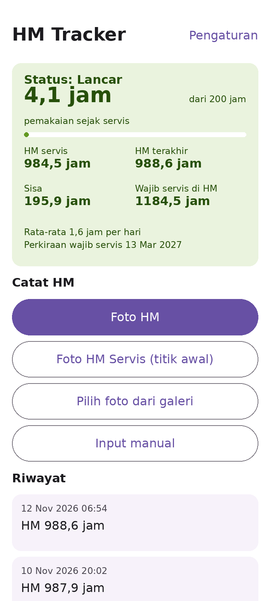
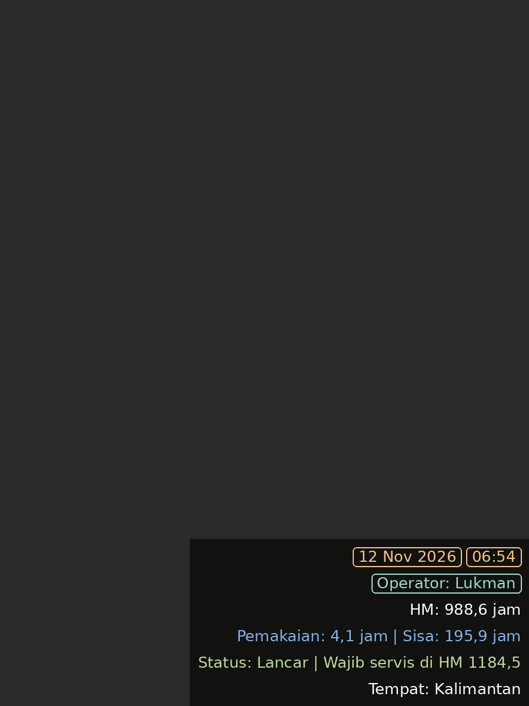

# HM Tracker

Aplikasi Android untuk mencatat jam meter (Engine Hours), menghitung pemakaian sejak servis, dan memberi status warna. Setiap foto diberi watermark berisi tanggal, jam, HM, pemakaian, sisa jam, status, dan tempat.

## Tampilan utama

## Contoh watermark

- Tanggal, jam, dan operator diberi bingkai.
- Baris operator hanya muncul jika kolom operator diisi.
- Warna status mengikuti kondisi: hijau untuk Lancar, kuning untuk Peringatan, dan merah untuk Wajib servis.

## Cara memasang (tanpa Android Studio)

1. Buka tab **Actions** di repositori, pilih **Build APK**, lalu tunggu sampai bertanda hijau.
2. Buka hasil build, unduh artifact **HMTracker-debug**, dan ekstrak file `app-debug.apk`.
3. Pasang APK di HP. Izinkan pemasangan dari sumber tidak dikenal jika diminta.

## Pemakaian pertama kali

1. Buka **Pengaturan**, isi **Tempat** dan **Batas servis** (default 200 jam).
2. Tekan **Foto HM Servis (titik awal)**, periksa angka HM, lalu **Simpan**.
3. Untuk pembacaan berikutnya, tekan **Foto HM**. Aplikasi membaca HM dari foto dan menampilkannya untuk dicek sebelum disimpan.

## Status

- **Hijau (Lancar):** sisa lebih dari 20 jam.
- **Kuning (Peringatan):** sisa 20 jam atau kurang.
- **Merah (Wajib servis):** pemakaian sudah mencapai batas servis.

## Catatan

- Pembacaan HM otomatis dari foto bisa keliru, terutama jika foto silau. Angka selalu ditampilkan dulu untuk dikonfirmasi.
- Watermark tertulis langsung di foto yang disimpan, sehingga angka di layar cek hasil baca harus benar sebelum disimpan.
- Data disimpan di HP. Tidak ada sinkronisasi antar HP.
